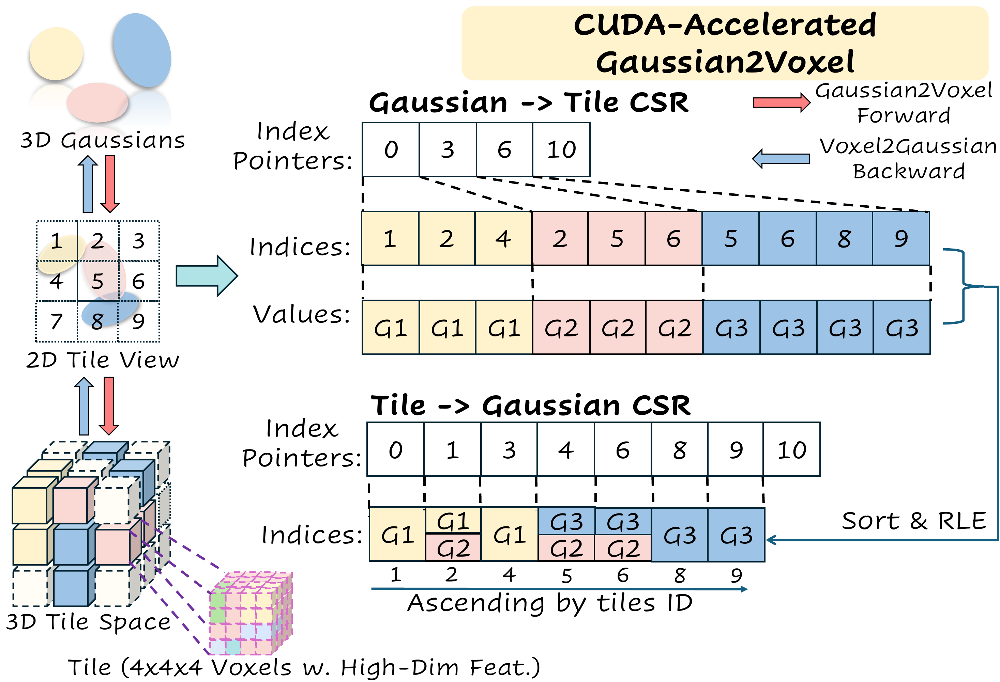

<p align="center">
  <picture>
    <source media="(prefers-color-scheme: light)" srcset="img/logo.svg">
    
  </picture>
</p>

<p align="center">
  The CUDA Gaussian-to-Voxel (G2V) splatting module of
  <a href="https://lunarlab-gatech.github.io/ShelfGaussian/"><b>ShelfGaussian</b></a> (CVPR 2026 Findings)
  <br>
  <a href="https://lunarlab-gatech.github.io/ShelfGaussian/">Project page</a> ·
  <a href="https://arxiv.org/abs/2512.03370">Paper</a> ·
  <a href="https://github.com/lunarlab-gatech/ShelfGaussian">ShelfGaussian code</a>
</p>

CudaGaussianVoxelizer splats 3D Gaussians and their high-dimensional features into a dense voxel grid, with both the forward and the backward pass written in CUDA. One training step (forward + backward) is **191–382× faster than GaussTR** and **5–6× faster than GaussianFormer**, and uses **2–4.6× less GPU memory**.

## Method

For every voxel, the module adds up the density of all Gaussians that overlap it and averages their features, weighted by that density. The voxel grid is split into **tiles of 4×4×4 voxels**. The module links Gaussians and tiles through two Compressed Sparse Row (CSR) maps:

- **Forward uses the Tile→Gaussian CSR.** Each Gaussian lists the tiles its bounding box touches (the Gaussian→Tile CSR). Sorting these pairs by tile ID and run-length encoding them gives the Tile→Gaussian CSR. Each CUDA block then handles one tile, and its threads sum only the Gaussians listed for that tile. Neighbouring voxels read the same Gaussians, which keeps the data in L1 cache and avoids repeated loads.
- **Backward uses the Gaussian→Tile CSR.** The backward reuses the Gaussian→Tile CSR from the forward. Each CUDA block handles one Gaussian, walks the tiles it touches, and reduces the gradients for its mean, covariance, opacity and features inside the block, so no atomic operations are needed.
- **Every Gaussian counts.** A Gaussian centered outside the voxel range still contributes to the voxels it overlaps (GaussianFormer ignores such Gaussians). The feature dimension can be anything, for example 768-D or 1024-D foundation-model features.

<p align="center">
  Tile and Tile->Gaussian CSR between 3D Gaussians and 4x4x4 voxel tiles" width="760">
</p>

## Installation

You need an NVIDIA GPU, PyTorch with CUDA, and a CUDA toolkit (`nvcc`) that matches PyTorch's CUDA version. The module was developed with PyTorch 2.1.2 + CUDA 11.8 (see [requirements.txt](requirements.txt)). It also builds with PyTorch 2.7 + CUDA 12.8, which RTX 50-series GPUs require.

```bash
git clone https://github.com/Yandong-Luo/CudaGaussianVoxelizer.git
cd CudaGaussianVoxelizer
pip install -r requirements.txt          # PyTorch 2.1.2 + CUDA 11.8; skip if PyTorch is already installed
pip install --no-build-isolation -e .
```

`--no-build-isolation` lets the build use the PyTorch you already have installed. To compile only for your own GPU, set `TORCH_CUDA_ARCH_LIST` first, for example `TORCH_CUDA_ARCH_LIST="8.9"` for an L40S or RTX 40-series card.

### Quick start

```python
import torch
from CudaGaussianVoxelizer import PyCudaGaussianVoxelizer

N, C = 18000, 1024                                    # Gaussians, feature dim
voxelizer = PyCudaGaussianVoxelizer(
    voxel_size=[0.4, 0.4, 0.4],
    voxel_range=[-40.0, -40.0, -1.0, 40.0, 40.0, 5.4],   # -> 200 x 200 x 16 voxels
)

lo = torch.tensor([-40.0, -40.0, -1.0], device="cuda")
hi = torch.tensor([40.0, 40.0, 5.4], device="cuda")
means3D = (torch.rand(N, 3, device="cuda") * (hi - lo) + lo).requires_grad_()     # (N, 3)
opacity = torch.rand(N, device="cuda").requires_grad_()                           # (N,)
R, _ = torch.linalg.qr(torch.randn(N, 3, 3, device="cuda"))
var = torch.rand(N, 3, device="cuda") * 2.0 + 0.5
covariances = (R @ torch.diag_embed(var) @ R.mT).reshape(N, 9).requires_grad_()   # (N, 9) flattened 3x3
features = torch.randn(N, C, device="cuda").requires_grad_()                      # (N, C), optional

density, grid_feats, stats = voxelizer(means3D, opacity, covariances, features)
print(density.shape, grid_feats.shape)              # (200, 200, 16), (200, 200, 16, 1024)

(density.sum() + grid_feats.sum()).backward()       # grads for means3D, opacity, covariances, features
```

`stats` holds the forward and backward time in seconds. The backward time is filled in after `.backward()` runs.

To check the kernels against a brute-force PyTorch reference (density, features, and the gradients of all inputs), run `python test/test_reference.py`. It needs no extra data.

The repo also has a CUDA feature cosine loss, `PyCudaFeatsCosineLoss`; see [test/test_feats_loss_forward.py](test/test_feats_loss_forward.py) and [test/test_feats_loss_backward.py](test/test_feats_loss_backward.py).

## Performance

This is the G2V splatting benchmark from the paper (Table 13), run on one NVIDIA L40S 48 GB GPU. FW and BW are the forward and backward times in seconds, and Mem. is GPU memory in GB.

<table>
  <thead>
    <tr>
      <th rowspan="2">Method</th>
      <th colspan="3">18k Gaussians, 1024-D features</th>
      <th colspan="3">9k Gaussians, 768-D features</th>
    </tr>
    <tr>
      <th>FW (s)</th><th>BW (s)</th><th>Mem. (GB)</th>
      <th>FW (s)</th><th>BW (s)</th><th>Mem. (GB)</th>
    </tr>
  </thead>
  <tbody>
    <tr><td>Taichi</td><td align="center">–</td><td align="center">–</td><td align="center">Fail</td><td align="center">–</td><td align="center">–</td><td align="center">Fail</td></tr>
    <tr><td>GaussianFlowOcc</td><td align="center">–</td><td align="center">–</td><td align="center">OOM</td><td align="center">–</td><td align="center">–</td><td align="center">OOM</td></tr>
    <tr><td>GaussTR</td><td align="center">14.1</td><td align="center">596.7</td><td align="center">22.3</td><td align="center">12.4</td><td align="center">446.4</td><td align="center">14.8</td></tr>
    <tr><td>GaussianFormer</td><td align="center">5.4</td><td align="center">13.4</td><td align="center">12.9</td><td align="center">1.9</td><td align="center">4.2</td><td align="center">7.7</td></tr>
    <tr><td><b>CudaGaussianVoxelizer (ShelfGaussian)</b></td><td align="center"><b>0.5</b></td><td align="center"><b>2.7</b></td><td align="center"><b>4.9</b></td><td align="center"><b>0.2</b></td><td align="center"><b>1.0</b></td><td align="center"><b>3.7</b></td></tr>
  </tbody>
</table>

Fail means the method exceeds Taichi's structural compiler limit, and OOM means it runs out of memory on the 48 GB GPU.

How much faster is it? Each speedup below is the other method's time divided by ours.

| Compared with  | Setting       | Forward    | Backward   | Forward + backward | Memory    |
| -------------- | ------------- | ---------: | ---------: | -----------------: | --------: |
| GaussTR        | 18k, 1024-D   | **28×**    | **221×**   | **191×**           | 4.6× less |
| GaussTR        | 9k, 768-D     | **62×**    | **446×**   | **382×**           | 4.0× less |
| GaussianFormer | 18k, 1024-D   | **10.8×**  | **5.0×**   | **5.9×**           | 2.6× less |
| GaussianFormer | 9k, 768-D     | **9.5×**   | **4.2×**   | **5.1×**           | 2.1× less |

With 18k Gaussians and 1024-D features, one forward + backward pass takes **3.2 s**. GaussTR needs 610.8 s and GaussianFormer needs 18.8 s for the same pass, and Taichi and GaussianFlowOcc cannot run this setting at all.

## Citation

If you find this module useful, please cite ShelfGaussian:

```bibtex
@inproceedings{zhao2026shelfgaussian,
  title={ShelfGaussian: Shelf-supervised open-vocabulary gaussian-based 3D scene understanding},
  author={Zhao, Lingjun and Luo, Yandong and Hays, James and Gan, Lu},
  booktitle={Proceedings of the IEEE/CVF Conference on Computer Vision and Pattern Recognition},
  pages={1398--1409},
  year={2026}
}
```
